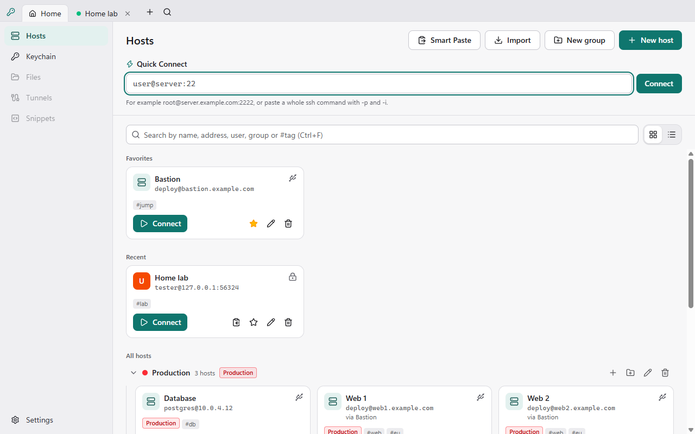
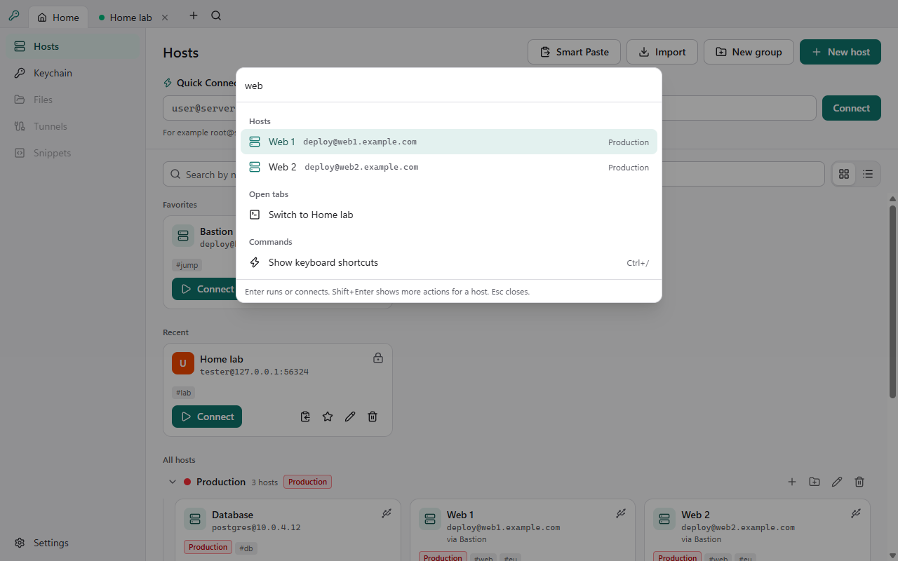
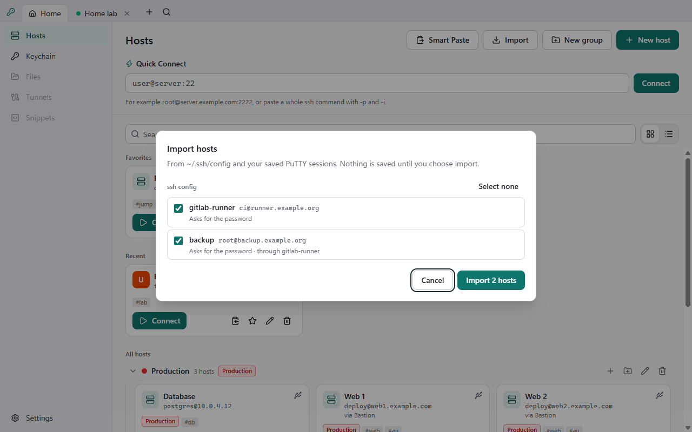
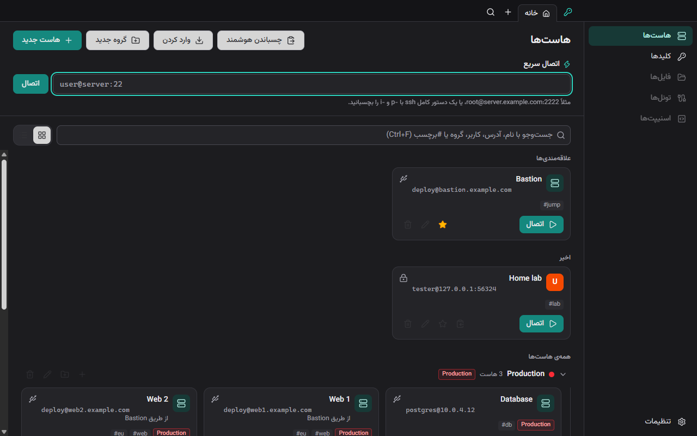

<div align="center">


# Kelidar

**A free, open-source SSH manager for Windows.**
Connect to a server in two steps. Everything else stays out of the way until you need it.

[](https://github.com/kelidar-app/kelidar-windows/actions/workflows/ci.yml)
[](https://github.com/kelidar-app/kelidar-windows/releases)
[](LICENSE)


</div>

> [!WARNING]
> Kelidar is in alpha (phase 2 of 7 on the [roadmap](docs/ROADMAP.md)). Day-to-day SSH work is
> covered, file transfer and tunnels come next. Export a backup file now and then (Settings →
> Security) while the app is young.



## Why Kelidar

- **Local-first.** No account, no cloud, no telemetry. Your hosts and secrets stay on your PC.
- **Simple by default.** The host form has four fields: name, address, user name and sign-in method. The rest sits under "More options".
- **Secure by design.** Passwords and keys live in an encrypted vault and never reach the user interface.
- **Keyboard first.** Every action is in the command palette (Ctrl+K) and has a shortcut.
- **English and Persian**, with a full right-to-left layout.

## Features

**Hosts**

- Groups and subgroups that pass down a port, environment, identity and jump host; tags,
  favorites, recent hosts, card and list views, and search by name, address, user, group, tag or notes
- Move hosts and groups by drag and drop
- Notes and links per host, and a badge with the server's system after the first connection
- Import from `~/.ssh/config` and saved PuTTY sessions (offered on first run), and Smart Paste:
  paste a hosting provider's e-mail and check the filled-in form before saving

**Sign-in**

- Passwords, private keys (OpenSSH, PEM, PuTTY), the Windows OpenSSH agent and Pageant
- A Keychain of keys and shared identities; generate Ed25519 or RSA keys
- "Upgrade to key login": shows the exact command, installs the key, tests it, then switches the host
- Two-factor codes when the server asks

**Connections and terminal**

- Quick Connect: type `user@host` or paste a whole `ssh` command
- Jump hosts, SOCKS5 and HTTP proxies, agent forwarding, a startup command
- Automatic reconnect, and sticky sessions (tmux) that pick up where you left off
- Tabs and split panes (drag a tab into another), search, clickable links, zoom, a paste guard
  for multi-line text, production hosts marked in red, and a hotkey that types the sudo password
- Trust on first use with SHA-256 host key fingerprints; a changed key blocks the connection

**Security and data**

- Optional master password, lock screen, and auto-lock after idle time or when Windows locks
- Copied passwords leave the clipboard after 30 seconds
- Encrypted export and import, and ten automatic backups you can restore
- Updates from GitHub Releases, installed when you choose "Restart to update"

The full list, with the phase each feature arrives in, is in [docs/FEATURES.md](docs/FEATURES.md).

<table>
  <tr>
    <td></td>
    <td></td>
  </tr>
  <tr>
    <td colspan="2"></td>
  </tr>
</table>

## Download

Get the latest installer (`Kelidar-Setup-<version>-x64.exe`) from
[Releases](https://github.com/kelidar-app/kelidar-windows/releases). It installs for the current
user only and needs no admin rights.

The installer is not code-signed yet, so Windows SmartScreen may warn you. Choose
**More info → Run anyway** if you trust the download. To check that the file is the one we built,
compare its hash with `SHA256SUMS.txt` from the same release:

```powershell
Get-FileHash .\Kelidar-Setup-0.2.0-x64.exe -Algorithm SHA256
```

### Updates

Kelidar checks [Releases](https://github.com/kelidar-app/kelidar-windows/releases) when it starts
(you can turn this off in Settings), downloads a new version in the background and shows
**Restart to update** when it is ready. The check sends nothing but the request for the release
list. Until the installer is code-signed, a downloaded update is checked against the SHA-512 hash
published with the same release.

## Build from source

You need Windows 10 or 11 (x64), [Node.js](https://nodejs.org/) 24 LTS (see `.node-version`) and
Git. No C++ build tools are needed.

```powershell
git clone https://github.com/kelidar-app/kelidar-windows.git
cd kelidar-windows
npm ci
npm run dev
```

| Command               | What it does                                          |
| --------------------- | ----------------------------------------------------- |
| `npm run dev`         | Start the app with hot reload                         |
| `npm run typecheck`   | Type-check main, preload, renderer and tests          |
| `npm run lint`        | ESLint with no warnings allowed                       |
| `npm test`            | Unit and integration tests (Vitest)                   |
| `npm run test:e2e`    | Playwright smoke tests against Electron (build first) |
| `npm run dist`        | Build the NSIS installer into `dist/`                 |
| `npm run screenshots` | Make the README screenshots (build first)             |

## Security

- The window runs with context isolation, the sandbox on and no Node.js integration, and is served
  from a custom `app://` protocol under a strict Content Security Policy.
- All privileged work happens in the main process behind one typed IPC contract; every message is
  validated with zod.
- The vault is a single file encrypted with AES-256-GCM. Its key is protected by Windows DPAPI
  through Electron `safeStorage`, or, with a master password, by a key derived with scrypt.
- A locked app shows nothing but the lock screen, and the passwords and keys of open
  connections leave memory until you unlock.
- Secrets never reach the renderer, the logs or error messages.

The full design is in [docs/ARCHITECTURE.md](docs/ARCHITECTURE.md). To report a vulnerability,
see [SECURITY.md](SECURITY.md). Please do not open a public issue for it.

## Project layout

```text
src/main       Node.js main process: vault, SSH sessions, IPC handlers
src/preload    contextBridge only
src/renderer   React user interface
src/shared     Types and zod schemas shared by all three
tests/         Unit, integration (in-process SSH server) and Playwright tests
docs/          Features, architecture and roadmap (in Persian)
```

## Contributing

Bug reports and ideas are welcome in [Issues](https://github.com/kelidar-app/kelidar-windows/issues).
Before you open a pull request, read [CONTRIBUTING.md](CONTRIBUTING.md). Commit messages follow
[Conventional Commits](https://www.conventionalcommits.org/), because releases and the
[changelog](CHANGELOG.md) are made from them.

## License

[MIT](LICENSE) © Kelidar contributors
