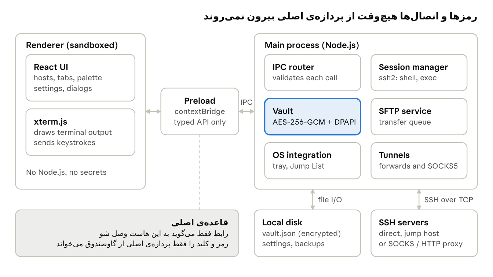

<div dir="rtl">

# معماری فنی

> نسخه‌ی Markdown تب «معماری فنی» از سند اصلی پروژه، به تاریخ ۱۵ نوامبر ۲۰۲۶.

هسته‌ی SSH در پردازه‌ی اصلی Electron اجرا می‌شود و رابط کاربری هیچ‌وقت به رمزها و کلیدهای خصوصی دسترسی مستقیم ندارد.

## استک

هسته‌ی فنی سه کتابخانه است: Electron برای پوسته، ssh2 برای اتصال و xterm.js برای ترمینال. نسخه‌ها مربوط به تاریخ همین سند است.

| بخش | انتخاب | نقش و نکته |
| --- | --- | --- |
| چارچوب | [Electron 45](https://releases.electronjs.org/schedule) | نسخه‌ی پایدار فعلی، منتشرشده در ۲۰ اکتبر ۲۰۲۶ با Chromium 156 و Node 24. فقط سه نسخه‌ی اصلی آخر پشتیبانی می‌شوند، پس Electron باید مرتب به‌روز شود |
| ابزار ساخت | [electron-vite 5](https://electron-vite.org/blog) | یک پیکربندی برای هر سه بخش main، preload و renderer |
| بسته‌بندی و آپدیت | [electron-builder و electron-updater](https://www.electron.build/docs/features/auto-update) | نصب‌کننده‌ی NSIS و آپدیت خودکار از GitHub Releases |
| اتصال SSH | [ssh2 نسخه‌ی 1.17](https://cdn.jsdelivr.net/npm/ssh2@1.17.0/README.md) | شل، اجرای دستور، SFTP، تونل، agent و میزبان پرشی در یک کتابخانه با مجوز MIT. سرور آزمایشی هم دارد که تست خودکار را بدون سرور واقعی ممکن می‌کند |
| ترمینال | [xterm.js 6](https://newreleases.io/project/npm/@xterm/xterm/release/6.0.0) | با افزونه‌های fit، webgl، search، web-links، serialize و unicode-graphemes. افزونه‌ی canvas در نسخه‌ی ۶ حذف شده و رندر DOM یا WebGL مانده است |
| رابط کاربری | React، TypeScript در حالت strict، Tailwind CSS و shadcn/ui | کامپوننت‌های دسترس‌پذیر و کلاس‌های منطقی که راست‌به‌چپ را ساده می‌کنند |
| وضعیت و اعتبارسنجی | Zustand و Zod | نگهداری وضعیت رابط؛ بررسی همه‌ی پیام‌های IPC و فایل‌های ورودی |
| چندزبانه | i18next | فایل ترجمه‌ی جدا برای فارسی و انگلیسی |
| رمزنگاری | ماژول crypto خود Node و [safeStorage](https://electronjs.org/docs/latest/api/safe-storage) | الگوریتم AES-256-GCM و scrypt بدون وابستگی اضافه؛ کلید با DPAPI ویندوز محافظت می‌شود |
| خواندن ssh config | [ssh-config](https://github.com/cyjake/ssh-config) | تجزیه و تولید فایل ssh config، با مجوز MIT |
| تست | Vitest و Playwright | تست واحد و یکپارچه، و تست رابط روی خود Electron |

سه نکته که از همین حالا باید رعایت شود:

- رابط هم‌زمان (sync) در safeStorage منسوخ شده و طبق مستندات در Electron 46 حذف می‌شود؛ فقط نسخه‌ی async استفاده شود.
- کتابخانه‌ی ssh2 یک بخش native اختیاری دارد. برنامه باید بدون آن هم کار کند تا ساخت پروژه به ابزار کامپایل native نیاز نداشته باشد؛ این در فاز ۱ آزمایش می‌شود.
- در پرامپت‌ها از ابزار کدنویسی خواسته شده آخرین نسخه‌ی پایدار هر کتابخانه را نصب کند و رابط‌ها را با مستندات روز تطبیق دهد.

## نمای کلی



رابط کاربری در محیطی ایزوله اجرا می‌شود و فقط از راه پل preload با پردازه‌ی اصلی حرف می‌زند. همه‌ی کارهای حساس، یعنی vault، اتصال SSH، انتقال فایل و تونل، در پردازه‌ی اصلی انجام می‌شوند. اگر روزی بار اتصال‌ها سنگین شد، سرویس نشست‌ها بدون تغییر رابط به یک utilityProcess جدا منتقل می‌شود.

## ساختار پوشه‌های پروژه

سه لایه‌ی main، preload و renderer از هم جدا هستند و فقط پوشه‌ی shared بین هر سه مشترک است.

</div>

```text
kelidar-windows/
├─ src/
│  ├─ shared/           types, zod schemas, IPC contract
│  ├─ main/
│  │  ├─ index.ts       app lifecycle, single instance, windows
│  │  ├─ ipc/           one router: checks sender, parses payload, calls services
│  │  ├─ vault/         encryption, key wrapping, atomic save, backups
│  │  ├─ ssh/           SessionManager, auth, host keys, jump hosts, reconnect
│  │  ├─ sftp/          file operations, transfer queue
│  │  ├─ tunnels/       local, remote, SOCKS5
│  │  ├─ tools/         agentless server tools
│  │  ├─ importers/     ssh config, PuTTY, WinSCP, CSV
│  │  ├─ platform/      Windows-only code: tray, Jump List, protocol, autostart
│  │  └─ updater/       electron-updater wiring
│  ├─ preload/
│  │  └─ index.ts       contextBridge: exposes the typed api, nothing else
│  └─ renderer/
│     ├─ app/           shell layout, command palette
│     ├─ features/      hosts, terminal, files, tunnels, snippets, toolbox, settings
│     ├─ components/    shared UI primitives
│     ├─ stores/        zustand stores, never any secret
│     ├─ i18n/          en.json, fa.json
│     └─ styles/        tokens, themes
├─ tests/               unit, integration (in-process ssh2 server), e2e
├─ resources/           icons, installer assets
├─ docs/                these documents as Markdown
├─ prompts/             one prompt per phase, plus helper prompts
├─ AGENTS.md            project rules for AI coding tools
├─ electron.vite.config.ts
├─ electron-builder.yml
└─ package.json
```

<div dir="rtl">

دو قاعده: کد مخصوص ویندوز فقط در پوشه‌ی `platform` نوشته می‌شود، و هیچ فایلی در renderer چیزی از main را مستقیم import نمی‌کند.

## مدل داده

هر رکورد شناسه، زمان ساخت، زمان آخرین تغییر و نشانه‌ی حذف دارد تا بعداً بشود دو نسخه از داده‌ها را با هم ادغام کرد. رمزها جدا از بقیه نگه داشته می‌شوند تا فهرست هاست‌ها بدون هیچ رمزی به رابط برود.

</div>

```ts
type ID = string; // uuid
interface Base { id: ID; createdAt: string; updatedAt: string; deletedAt?: string }

interface Host extends Base {
  name: string;
  address: string;               // hostname or IP
  port?: number;                 // default 22, may come from the group
  groupId?: ID;
  tags: string[];
  identityId?: ID;               // shared credentials, may come from the group
  username?: string;             // only when no identity is used
  auth?: AuthRef;
  jumpHostId?: ID;               // another Host
  proxy?: { type: 'socks5' | 'http'; host: string; port: number; secretId?: ID };
  environment?: 'production' | 'staging' | 'development';
  color?: string; icon?: string; favorite?: boolean;
  startupCommand?: string; stickySession?: boolean;
  agentForward?: boolean; legacyAlgorithms?: boolean;
  notes?: string; links?: { label: string; url: string }[];
  renewal?: { date: string; monthlyCost?: number; currency?: string };
  osInfo?: { id: string; version?: string };
  lastConnectedAt?: string;
}

type AuthRef =
  | { type: 'password'; secretId: ID }
  | { type: 'key'; keyId: ID }
  | { type: 'agent' }
  | { type: 'ask' };            // prompt every time

interface Group extends Base {
  name: string; parentId?: ID; color?: string;
  defaults?: Pick<Host, 'port' | 'identityId' | 'jumpHostId' | 'environment'>;
}
interface Identity extends Base { name: string; username: string; auth: AuthRef }
interface SshKey extends Base {
  name: string; type: 'ed25519' | 'rsa' | 'ecdsa';
  publicKey: string; fingerprint: string;
  privateKeySecretId: ID; passphraseSecretId?: ID;
}
interface Secret { id: ID; value: string }   // never leaves the main process
interface KnownHost { host: string; port: number; keyType: string; fingerprint: string; addedAt: string }
interface Tunnel extends Base {
  name: string; hostId: ID; type: 'local' | 'remote' | 'dynamic';
  bindHost: string; bindPort: number;
  targetHost?: string; targetPort?: number; autoStart?: boolean;
}
interface Snippet extends Base {
  name: string; command: string; description?: string; tags: string[];
  variables?: { name: string; default?: string }[];
}
interface Workspace extends Base { name: string; layout: unknown; tunnelIds: ID[] }
```

<div dir="rtl">

تنظیمات غیرحساس، مثل تم و اندازه‌ی پنجره، در فایل جدای `settings.json` می‌مانند و رمزنگاری نمی‌شوند.

## قرارداد IPC

رابط فقط از راه یک قرارداد تایپ‌شده با هسته حرف می‌زند؛ هر کانال جدید اول در `src/shared/ipc.ts` تعریف می‌شود.

| کانال | جهت | کار |
| --- | --- | --- |
| `vault:status`، `vault:unlock`، `vault:lock` | رابط به هسته | وضعیت vault و باز و بسته کردنش |
| `hosts:list`، `hosts:save`، `hosts:delete` | رابط به هسته | فهرست و ویرایش هاست‌ها، همیشه بدون رمز |
| `session:open`، `session:input`، `session:resize`، `session:close` | رابط به هسته | باز کردن نشست و فرستادن ورودی کاربر |
| `session:data`، `session:state` | هسته به رابط | خروجی ترمینال و تغییر وضعیت اتصال |
| `prompt:request`، `prompt:answer` | هر دو | پرسش‌های هسته از کاربر: تأیید کلید سرور، رمز، کد دومرحله‌ای |
| `secret:copy` | رابط به هسته | هسته رمز را مستقیم در کلیپ‌بورد می‌گذارد و مقدارش به رابط نمی‌رسد |
| `sftp:*`، `tunnel:*`، `tools:*` | رابط به هسته | فایل، تونل و جعبه‌ابزار، هر کدام در فاز خودش |

چهار قاعده برای همه‌ی کانال‌ها:

1. هر handler اول فرستنده‌ی پیام را بررسی می‌کند و بعد ورودی را با Zod می‌سنجد.
2. هیچ پاسخی مقدار رمز یا کلید خصوصی ندارد.
3. خروجی ترمینال هر چند میلی‌ثانیه یک بار دسته‌ای فرستاده می‌شود و اگر رابط عقب بماند، خواندن از سرور موقتاً متوقف می‌شود.
4. خطاها با کد ثابت برمی‌گردند و متن ترجمه‌شده‌شان در رابط ساخته می‌شود.

## امنیت

داده‌ها در برابر دو خطر محافظت می‌شوند: کسی که فایل‌های برنامه را به دست می‌آورد، و محتوای مخربی که در ترمینال یا رابط نمایش داده می‌شود.

**آنچه vault محافظت نمی‌کند.** طبق [مستندات safeStorage](https://electronjs.org/docs/latest/api/safe-storage)، محافظت DPAPI جلوی کاربران دیگر همان سیستم را می‌گیرد، ولی جلوی برنامه‌ای را که با حساب خود کاربر اجرا می‌شود نمی‌گیرد. برای این حالت، رمز اصلی و قفل خودکار در فاز ۲ اضافه می‌شود.

**طراحی vault**

- یک فایل `vault.json` در پوشه‌ی داده‌ی برنامه، با سرآیند نسخه و پارامترها و یک بدنه‌ی رمزنگاری‌شده.
- بدنه با AES-256-GCM و یک کلید تصادفی ۲۵۶ بیتی رمز می‌شود و هر ذخیره nonce تازه دارد.
- حالت پیش‌فرض: کلید با safeStorage، یعنی DPAPI ویندوز، بسته‌بندی می‌شود و کاربر رمزی وارد نمی‌کند.
- حالت رمز اصلی: کلید با کلیدی که scrypt از رمز کاربر می‌سازد بسته‌بندی می‌شود و نسخه‌ی DPAPI حذف می‌شود.
- ذخیره‌ی اتمی: نوشتن در فایل موقت و بعد تغییر نام؛ ده نسخه‌ی آخر به‌عنوان پشتیبان می‌مانند.
- رمزها فقط در حافظه‌ی پردازه‌ی اصلی‌اند و با قفل شدن برنامه پاک می‌شوند.

**کلید سرور.** اولین اتصال اثرانگشت SHA-256 را نشان می‌دهد و ذخیره می‌کند؛ اگر بعداً عوض شود اتصال متوقف می‌شود.

**سخت‌سازی Electron** بر اساس [فهرست امنیتی رسمی](https://electronjs.org/docs/latest/tutorial/security):

- حالت‌های contextIsolation و sandbox روشن می‌مانند و nodeIntegration خاموش.
- برنامه از پروتکل اختصاصی `app://` بار می‌شود، نه از `file://`، و CSP سخت‌گیر دارد.
- هر جابه‌جایی صفحه و هر پنجره‌ی جدید رد می‌شود؛ لینک بیرونی فقط بعد از بررسی، در مرورگر سیستم باز می‌شود.
- فرستنده‌ی همه‌ی پیام‌های IPC بررسی می‌شود.
- با `@electron/fuses` قابلیت‌هایی مثل runAsNode و بازرسی از خط فرمان خاموش می‌شوند.
- برنامه همیشه روی یکی از سه نسخه‌ی پشتیبانی‌شده‌ی Electron می‌ماند.

**ترمینال.** نوشتن سرور در کلیپ‌بورد (OSC 52) پیش‌فرض خاموش است، چسباندن چندخطی تأیید می‌خواهد و فقط لینک‌های http و https باز می‌شوند.

**لاگ و وابستگی‌ها.** هیچ رمزی در لاگ نوشته نمی‌شود، ضبط نشست فقط با انتخاب کاربر روشن می‌شود و وابستگی‌ها در هر build با `npm audit` بررسی می‌شوند.

## جریان‌های کلیدی

**اتصال**

1. رابط `session:open` را با شناسه‌ی هاست می‌فرستد.
2. هسته تنظیمات هاست را با پیش‌فرض‌های گروه ترکیب می‌کند و رمز یا کلید را از vault می‌خواند.
3. اگر میزبان پرشی یا پراکسی تعریف شده باشد، اول آن مسیر ساخته می‌شود و اتصال اصلی از داخلش می‌گذرد.
4. کلید سرور با فهرست شناخته‌شده‌ها مقایسه می‌شود: ناشناخته باشد از کاربر پرسیده می‌شود، تغییر کرده باشد اتصال متوقف می‌شود.
5. ورود به این ترتیب امتحان می‌شود: agent، کلید، رمز، پرسش تعاملی.
6. شل باز می‌شود؛ اگر «نشست ماندگار» روشن باشد، داخل tmux.
7. خروجی دسته‌دسته به رابط می‌رود و ورودی کاربر برمی‌گردد.
8. با قطع شدن اتصال، تب به حالت «اتصال دوباره» می‌رود و با فاصله‌های ۱، ۲، ۵، ۱۰ و ۳۰ ثانیه تلاش می‌کند.

**میزبان پرشی.** برنامه به سرور واسط وصل می‌شود، با `forwardOut` یک کانال به پورت SSH سرور مقصد باز می‌کند و همان کانال را به‌عنوان `sock` به اتصال دوم می‌دهد. برای زنجیره‌ی چندتایی همین کار تکرار می‌شود.

**تونل محلی و پویا.** یک سرور TCP روی سیستم کاربر گوش می‌دهد و هر اتصال ورودی را با `forwardOut` به مقصد می‌رساند. در تونل پویا، مقصد را برنامه‌ی مصرف‌کننده با پروتکل SOCKS5 اعلام می‌کند.

**تونل معکوس.** با `forwardIn` از سرور خواسته می‌شود روی یک پورت گوش بدهد؛ هر اتصالی که آن‌جا برسد به مقصدی روی سیستم کاربر وصل می‌شود.

**انتقال فایل.** روی همان اتصال یک کانال SFTP باز می‌شود. انتقال‌ها به شکل جریان و دوتا دوتا انجام می‌شوند تا ترمینال کند نشود. در «ویرایش با برنامه‌ی محلی» فایل در یک پوشه‌ی موقت خصوصی دانلود می‌شود و با هر ذخیره دوباره آپلود می‌شود.

**دنبال کردن پوشه.** شل سرور با یک خط تنظیم اختیاری، پوشه‌ی جاری را با کد OSC 7 اعلام می‌کند و پنل فایل آن را دنبال می‌کند. بدون این تنظیم، پنل فایل مستقل کار می‌کند.

## تست، بسته‌بندی و انتشار

**تست**

- تست واحد با Vitest: رمزنگاری vault، تجزیه‌ی ورودی «اتصال سریع»، واردکننده‌ها و طرح‌واره‌های IPC.
- تست یکپارچه با سرور داخلی ssh2: ورود با رمز و کلید، رمز اشتباه، تغییر کلید سرور، خروجی سنگین، SFTP و تونل؛ بدون نیاز به سرور واقعی.
- تست رابط با Playwright روی خود Electron: در هر فاز یک سناریوی کوتاه، از باز شدن برنامه تا دیدن خروجی ترمینال.
- آزمون دستی جعبه‌ابزار روی چهار توزیع: Ubuntu، Debian، AlmaLinux و Alpine.

**ساخت و انتشار**

- در GitHub Actions روی ویندوز: بررسی نوع، lint، تست و ساخت نصب‌کننده با هر push.
- با هر tag نسخه، نصب‌کننده‌ی NSIS و فایل `latest.yml` در GitHub Releases منتشر می‌شوند و [electron-updater](https://www.electron.build/docs/features/auto-update) نسخه‌ی جدید را از همان‌جا می‌گیرد.
- نصب برای کاربر فعلی انجام می‌شود و دسترسی مدیر نمی‌خواهد.
- نسخه‌گذاری به روش SemVer، پیام‌های commit به سبک Conventional Commits و یک فایل CHANGELOG.

**امضای کد.** نسخه‌های اول بدون امضا منتشر می‌شوند و ویندوز هنگام نصب هشدار SmartScreen نشان می‌دهد. [SignPath Foundation](https://signpath.org/terms) به پروژه‌های متن‌باز گواهی رایگان می‌دهد، به این شرط‌ها: مجوز تأییدشده‌ی OSI، نگهداری فعال، احراز هویت چندعاملی برای اعضای تیم و صفحه‌ی «سیاست امضای کد» در سایت پروژه. نام ناشر روی فایل امضاشده SignPath Foundation خواهد بود.

## منابع فنی

صفحه‌های بازشده در ۱۴ نوامبر ۲۰۲۶:

- زمان‌بندی انتشار Electron: [releases.electronjs.org/schedule](https://releases.electronjs.org/schedule)
- سیاست پشتیبانی نسخه‌های Electron: [electron-timelines](https://electronjs.org/docs/latest/tutorial/electron-timelines)
- مستندات safeStorage: [api/safe-storage](https://electronjs.org/docs/latest/api/safe-storage)
- فهرست امنیتی Electron: [tutorial/security](https://electronjs.org/docs/latest/tutorial/security)
- راهنمای نوار وظیفه‌ی ویندوز در Electron: [tutorial/windows-taskbar](https://electronjs.org/docs/tutorial/windows-taskbar)
- راهنمای لینک‌های اختصاصی در Electron: [tutorial/launch-app-from-url-in-another-app](https://www.electronjs.org/docs/tutorial/launch-app-from-url-in-another-app)
- مستندات ssh2 نسخه‌ی 1.17.0: [README](https://cdn.jsdelivr.net/npm/ssh2@1.17.0/README.md)
- یادداشت انتشار xterm.js 6.0.0: [newreleases.io](https://newreleases.io/project/npm/@xterm/xterm/release/6.0.0)
- وبلاگ electron-vite: [electron-vite.org/blog](https://electron-vite.org/blog)
- آپدیت خودکار در electron-builder: [features/auto-update](https://www.electron.build/docs/features/auto-update)
- کتابخانه‌ی ssh-config: [github.com/cyjake/ssh-config](https://github.com/cyjake/ssh-config)
- شرایط SignPath Foundation: [signpath.org/terms](https://signpath.org/terms)

</div>
