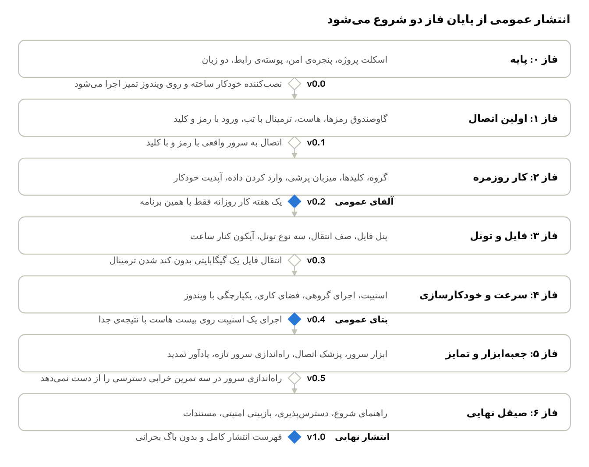

# نقشه راه

> نسخه‌ی Markdown تب «نقشه راه» از سند اصلی پروژه، به تاریخ ۱۵ نوامبر ۲۰۲۶.

هفت فاز، از اسکلت پروژه تا نسخه‌ی ۱.۰. اولین انتشار عمومی (آلفا) بعد از فاز ۲ است و نسخه‌ی بتا بعد از فاز ۴.

## نمای کلی

هر فاز با یک دروازه تمام می‌شود و تا معیارش برقرار نشود فاز بعد شروع نمی‌شود. سه دروازه‌ی رنگی انتشار عمومی‌اند: آلفا بعد از فاز ۲، بتا بعد از فاز ۴ و نسخه‌ی ۱.۰ بعد از فاز ۶. نقشه تاریخ ندارد، چون زمان هر فاز به ساعت کاری تو در هفته بستگی دارد؛ بزرگ‌ترین فازها ۲، ۴ و ۵ هستند.

## فاز ۰ — پایه (v0.0)

هدف: پوسته‌ی خالی ولی واقعی برنامه که به نصب‌کننده تبدیل می‌شود. حجم کار: کوچک.

- اسکلت پروژه با electron-vite، React و TypeScript سخت‌گیر
- پنجره‌ی امن، پروتکل اختصاصی و قفل تک‌نمونه
- قرارداد IPC تایپ‌شده با یک فراخوانی نمونه
- پوسته‌ی رابط: نوار عنوان با تب، نوار کناری و حالت خالی
- دو زبان با چیدمان راست‌به‌چپ؛ تم روشن و تیره
- ساخت خودکار نصب‌کننده در GitHub Actions

معیار عبور:

- [ ] دستور `npm run dev` پوسته را باز می‌کند و تغییر زبان، چیدمان را برمی‌گرداند
- [ ] ساخت خودکار سبز است و نصب‌کننده‌اش روی یک ویندوز ۱۱ تمیز نصب و اجرا می‌شود

## فاز ۱ — اولین اتصال (v0.1)

هدف: ذخیره‌ی هاست و کار در یک ترمینال واقعی. حجم کار: متوسط.

- فایل vault رمزنگاری‌شده با حساب ویندوز
- هاست با فرم چهارفیلدی و نوار اتصال سریع
- ترمینال با تب، کپی و چسباندن و تم
- ورود با رمز و کلید؛ تأیید کلید سرور
- پیام خطای خوانا برای هر نوع شکست

معیار عبور:

- [ ] اتصال به یک سرور واقعی با رمز و با کلید ed25519؛ برنامه‌های htop و vim درست کار می‌کنند
- [x] سه نشست هم‌زمان باز می‌مانند و قطع شبکه روی تب وضعیت روشنی نشان می‌دهد
- [x] تست خودکار ثابت می‌کند هیچ رمزی به رابط یا لاگ نمی‌رسد

## فاز ۲ — کار روزمره (v0.2، آلفای عمومی)

هدف: جایگزین برنامه‌ی فعلی در کار هر روز، و اولین نسخه‌ای که به دست دیگران می‌رسد. حجم کار: بزرگ‌ترین فاز.

- سازمان‌دهی: گروه، برچسب، جست‌وجو و پالت فرمان
- اعتبارنامه‌ها: هویت مشترک، مدیریت کلید، agent، ورود دومرحله‌ای و ارتقا به ورود بدون رمز
- دسترسی: میزبان پرشی، پراکسی، اتصال دوباره‌ی خودکار و نشست ماندگار
- راحتی ترمینال: تقسیم صفحه، جست‌وجو، رنگ محیط و محافظ production، پر کردن رمز sudo
- امنیت: رمز اصلی، قفل خودکار و پشتیبان رمزنگاری‌شده
- ورود داده: فایل ssh config، نشست‌های PuTTY و چسباندن هوشمند
- انتشار: آپدیت خودکار، README، مجوز و قالب گزارش باگ

معیار عبور:

- [ ] یک هفته کار روزانه فقط با همین برنامه
- [ ] نشست‌های PuTTY خودت کامل وارد می‌شوند
- [ ] بعد از ۳۰ ثانیه قطعی شبکه، اتصال برمی‌گردد و نشست ماندگار ادامه پیدا می‌کند
- [ ] برنامه خودش از نسخه‌ی 0.2.0 به 0.2.1 به‌روز می‌شود
- [ ] با vault قفل‌شده هیچ اطلاعات حساسی روی صفحه نیست

## فاز ۳ — فایل‌ها و تونل‌ها (v0.3)

هدف: برای فایل و تونل دیگر برنامه‌ی دومی لازم نباشد. حجم کار: متوسط.

- پنل فایل، صف انتقال و ویرایش با برنامه‌ی محلی
- دنبال کردن پوشه‌ی ترمینال و رها کردن فایل روی تب
- سه نوع تونل با پیش‌تنظیم، شروع خودکار و مسیر تصویری
- آیکون کنار ساعت و اعلان‌های ویندوز

معیار عبور:

- [ ] یک فایل ۱ گیگابایتی با checksum درست آپلود و دانلود می‌شود و ترمینال هم‌زمان روان می‌ماند
- [ ] تونل SOCKS5 به‌عنوان پراکسی مرورگر کار می‌کند
- [ ] تونل‌ها بعد از قطعی شبکه خودشان برمی‌گردند

## فاز ۴ — سرعت و خودکارسازی (v0.4، بتای عمومی)

هدف: کارهای تکراری با یک کلیک انجام شوند. حجم کار: بزرگ.

- اسنیپت با متغیر، بسته‌های آماده و دکمه‌ی اقدام سریع
- اجرای گروهی، ارسال هم‌زمان و فضای کاری
- مراقب تب، ضبط نشست و هایلایت
- حالت نمایش، تاریخچه‌ی اتصال، خروجی و فایل اشتراک
- فهرست پرش، میان‌بر سراسری، لینک‌های ssh و شروع با ویندوز

معیار عبور:

- [ ] یک اسنیپت روی ۲۰ هاست آزمایشی اجرا می‌شود و نتیجه‌ی هر کدام جدا می‌آید
- [ ] یک فضای کاری ۴ تب و ۲ تونل را با یک کلیک برمی‌گرداند
- [ ] در حالت نمایش هیچ نام واقعی در رابط برنامه دیده نمی‌شود
- [ ] کلیک روی یک لینک ssh بعد از تأیید کاربر نشست باز می‌کند

## فاز ۵ — جعبه‌ابزار و قابلیت‌های متمایز (v0.5)

هدف: قابلیت‌هایی که این برنامه را از بقیه جدا می‌کنند. حجم کار: بزرگ.

- نوار وضعیت، کارت سرور، پردازه‌ها، سرویس‌ها، Docker و لاگ‌بین
- تونل از روی پورت‌های باز
- پزشک اتصال و حالت سازگاری
- راه‌اندازی سرور تازه با محافظ قفل‌نشدن
- ممیزی دسترسی
- یادآور تمدید و هزینه با تاریخ شمسی
- ویرایشگر داخلی، ذخیره با sudo و پراکسی سیستم

معیار عبور:

- [ ] جعبه‌ابزار روی Ubuntu، Debian، AlmaLinux و Alpine کار می‌کند یا می‌گوید چه چیزی کم است
- [ ] راه‌اندازی سرور در سه تمرین خرابی دسترسی را از دست نمی‌دهد: کلید اشتباه، شروع نشدن دوباره‌ی sshd و بسته بودن پورت جدید در فایروال
- [ ] پزشک اتصال برای پنج خطای شبیه‌سازی‌شده مرحله‌ی درست را نام می‌برد

## فاز ۶ — صیقل نهایی و نسخه‌ی ۱.۰

هدف: نسخه‌ای که بشود به هر کسی داد. حجم کار: متوسط.

- راهنمای شروع و تنظیمات جست‌وجوپذیر
- ظاهر ویندوز ۱۱ و دسترس‌پذیری
- اندازه‌گیری و بهبود سرعت و حافظه
- واردکننده‌های بیشتر و نسخه‌ی قابل‌حمل
- بازبینی امنیتی کامل
- مستندات دوزبانه، winget و Scoop، و درخواست امضای کد

معیار عبور، که همان فهرست انتشار است:

- [ ] بازبینی امنیتی انجام شده و هر یافته یا رفع شده یا مستند شده
- [ ] زمان شروع، حافظه با ۲۰ تب و تأخیر تایپ اندازه‌گیری و ثبت شده
- [ ] مستندات فارسی و انگلیسی کامل است
- [ ] هیچ باگ بحرانی یا مهمی باز نیست
- [ ] صفحه‌ی «سیاست امضای کد» منتشر و درخواست SignPath ثبت شده

## بعد از نسخه‌ی ۱.۰

ترتیب این فهرست را بازخورد کاربران نسخه‌ی ۱.۰ تعیین می‌کند، نه این سند.

- شل محلی: تب PowerShell، CMD و WSL
- دستیار هوش مصنوعی اختیاری
- همگام‌سازی vault از راه پوشه‌ی دلخواه کاربر
- قفل با Windows Hello
- کپی سرور به سرور و همگام‌سازی پوشه
- ویرایشگر cron، فایروال و به‌روزرسانی‌ها در جعبه‌ابزار
- تغییر رمز گروهی
- ترمینال کشویی و پیشنهاد اسنیپت
- باز کردن با Remote Desktop
- پروتکل‌های Telnet و Serial
- سیستم افزونه
- نسخه‌ی مک و لینوکس

## ریسک‌ها و راه پیشگیری

بزرگ‌ترین خطر فنی نیست؛ بزرگ شدن دامنه قبل از اولین انتشار است.

| ریسک | اثر | پیشگیری |
| --- | --- | --- |
| بزرگ شدن دامنه | انتشار آلفا عقب می‌افتد و انگیزه از بین می‌رود | هر قابلیت فقط در فاز خودش ساخته می‌شود؛ ایده‌ی جدید به فهرست «بعد از ۱.۰» می‌رود |
| کد ناهماهنگ از ابزار هوش مصنوعی | معماری به هم می‌ریزد و باگ‌ها روی هم جمع می‌شوند | فایل AGENTS.md، کار قدم‌به‌قدم، تست در هر قدم و پرامپت بازبینی در پایان هر فاز |
| نشت رمز به رابط یا لاگ | اعتماد کاربران از بین می‌رود | رمزها فقط در پردازه‌ی اصلی؛ تست خودکار نشت از فاز ۱ |
| از دست رفتن vault | همه‌ی هاست‌ها و کلیدهای کاربر می‌رود | ذخیره‌ی اتمی، ده پشتیبان خودکار از فاز ۱ و خروجی دستی از فاز ۲ |
| قفل شدن کاربر بیرون از سرور | دسترسی به سرور قطع می‌شود | نشست فعلی باز می‌ماند، بازگشت خودکار تنظیم sshd و سه تمرین خرابی در فاز ۵ |
| هشدار SmartScreen | بعضی کاربران نصب نمی‌کنند | کد باز، انتشار checksum و درخواست امضای رایگان از SignPath |
| عقب ماندن از Electron | وصله‌های امنیتی دریافت نمی‌شود | پرامپت «ارتقای Electron» هر دو نسخه‌ی اصلی یک بار |
| تفاوت توزیع‌های لینوکس | جعبه‌ابزار روی بعضی سرورها خطا می‌دهد | دستورهای ساده و رایج، تشخیص وجود هر ابزار قبل از اجرا و آزمون روی چهار توزیع |
| کندی با خروجی سنگین یا تب زیاد | ترمینال قفل می‌کند و حافظه پر می‌شود | کنترل جریان خروجی از فاز ۱ و حالت کم‌مصرف در فاز ۶ |

